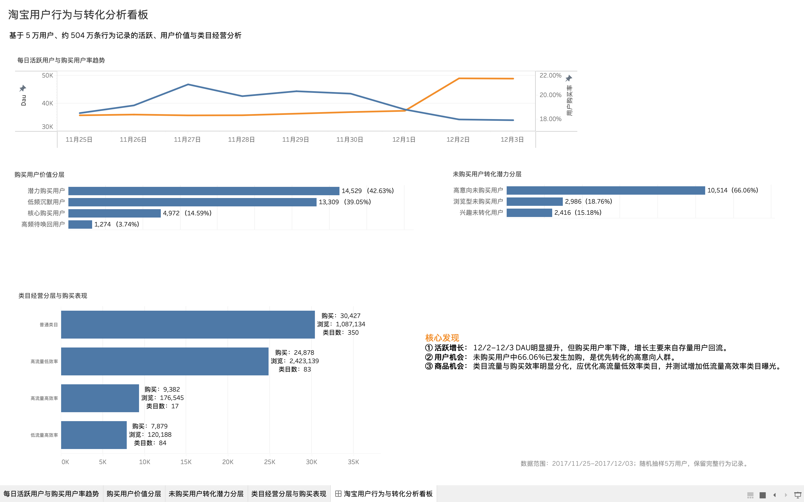

# 淘宝用户行为与转化分析

基于淘宝公开用户行为数据，使用 **Python + SQL + SQLite + Tableau** 完成数据清洗、用户行为分析、用户价值分层与类目经营分析，并搭建 Tableau 可视化看板。

## Dashboard


**在线交互版本：** https://public.tableau.com/app/profile/alex.xiao6194/viz/Taobao_User_Behavior_Analysis/sheet4


## 项目目标

本项目主要回答以下业务问题：

1. 用户活跃度及购买表现是否存在明显变化？
2. 活跃增长主要来自新用户还是存量用户？
3. 哪些用户具有更高的购买价值或转化潜力？
4. 哪些商品类目值得重点优化或增加曝光？

## 数据说明

数据来源：阿里云天池淘宝用户行为数据集。(https://tianchi.aliyun.com/dataset/649)

主要字段：

- `user_id`：用户 ID
- `item_id`：商品 ID
- `category_id`：商品类目 ID
- `behavior_type`：用户行为，包括 `pv`、`fav`、`cart`、`buy`
- `timestamp`：行为时间

原始数据约 **1 亿条行为记录**。

清洗后：

- 过滤异常时间记录 55,576 条
- 从约 98.8 万用户中随机抽取 5 万用户
- 保留抽样用户完整行为记录
- 最终分析样本约 **504 万条记录**
- 分析时间范围：2017-11-25 至 2017-12-03

> 原始数据体积较大，未上传至 GitHub。项目中仅保留分析代码及汇总结果。

## 分析流程

### 1. 数据清洗

使用 Python / Pandas：

- 分块读取亿级 CSV
- 检查缺失值与字段结构
- Unix Timestamp 转换为北京时间
- 识别并过滤异常时间数据
- 按用户抽样并保留完整行为记录
- 将分析样本导入 SQLite

### 2. 用户活跃分析

分析每日 DAU、购买用户数和购买用户率。

主要发现：

- 11/25–12/1 DAU 基本保持在 3.6–3.7 万
- 12/2–12/3 DAU 上升至约 4.9 万
- 同期购买用户率下降至约 17.9%
- 活跃增长主要来自此前已经出现过的存量用户回流

### 3. 用户价值分析

由于数据中没有商品金额字段，因此采用 **RF 模型**：

- **Recency**：距最近一次购买的时间
- **Frequency**：观察期内购买次数

购买用户分层结果：

| 用户类型 | 用户数 | 占比 |
|---|---:|---:|
| 潜力购买用户 | 14,529 | 42.63% |
| 低频沉默用户 | 13,309 | 39.05% |
| 核心购买用户 | 4,972 | 14.59% |
| 高频待唤回用户 | 1,274 | 3.74% |

### 4. 未购买用户转化潜力

在 15,916 名未购买用户中：

| 用户类型 | 用户数 | 占比 |
|---|---:|---:|
| 高意向未购买用户 | 10,514 | 66.06% |
| 浏览型未购买用户 | 2,986 | 18.76% |
| 兴趣未转化用户 | 2,416 | 15.18% |

其中约 **66% 的未购买用户已经产生过加购行为**，是优先转化的人群。

### 5. 类目经营分析

基于：

- 浏览量
- 购买量
- Buy / PV 比率

并结合四分位排名，对类目进行流量规模 × 购买效率分层。

主要结果：

- 高流量低效率类目：83 个
- 高流量高效率类目：17 个
- 低流量高效率类目：84 个

结果表明类目流量规模与购买效率存在明显分化。

## 核心结论

1. **活跃增长**：12/2–12/3 DAU 明显提升，但购买用户率下降，增长主要来自存量用户回流。
2. **用户机会**：未购买用户中 66.06% 已经产生加购行为，是最值得优先转化的人群。
3. **商品机会**：应重点优化高流量低效率类目，并测试增加低流量高效率类目的曝光。
4. **用户运营**：针对核心、潜力、沉默和待唤回用户采取差异化运营策略。

## 技术栈

- Python / Pandas
- SQL
- SQLite
- Tableau
- VS Code / Jupyter Notebook

## 项目结构

```text
Taobao-User-Behavior-Analysis/
├── notebooks/
│   └── 01_data_understanding.ipynb
├── sql/
│   ├── 01_user_activity.sql
│   ├── 02_retention_analysis.sql
│   ├── 04_behavior_path.sql
│   ├── 05_user_value.sql
│   └── 06_category_analysis.sql
├── output/
│   ├── daily_activity.csv
│   ├── user_value_segment.csv
│   ├── nonbuyer_segment.csv
│   └── category_segment.csv
├── images/
│   └── dashboard.png
└── README.md
```

## 数据来源

阿里云天池：淘宝用户购物行为数据集

项目参考与学习来源：和鲸社区相关用户行为分析案例。